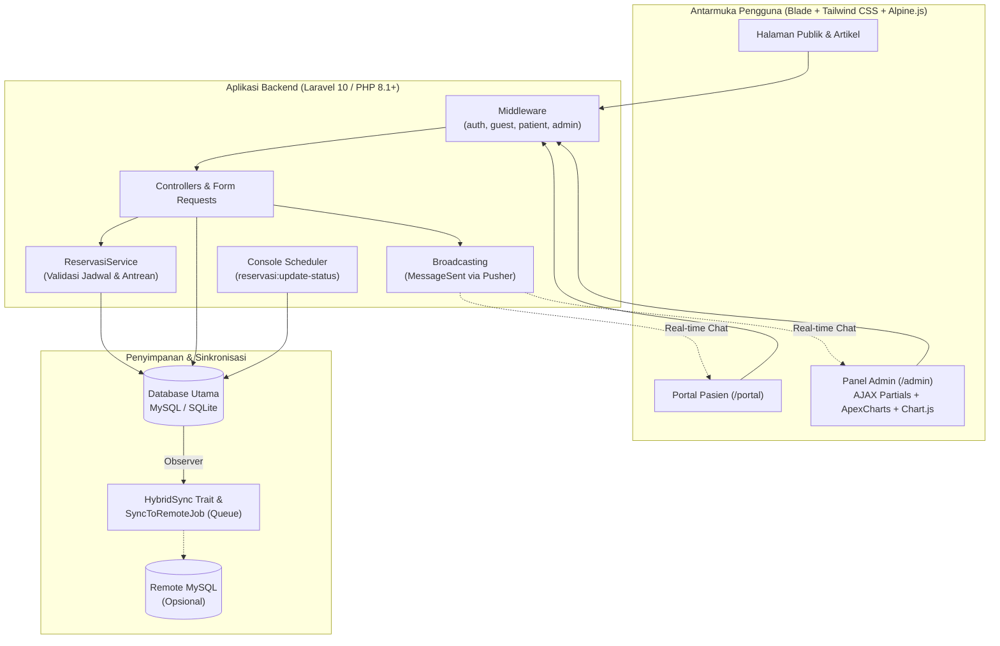

<p align="center">
  
</p>

<h1 align="center">DelimaCare</h1>

<p align="center">
  <strong>Platform Digital Terintegrasi untuk Manajemen Klinik Kesehatan Ibu, Anak &amp; Keluarga Berencana (KIA &amp; KB)</strong>
</p>

<p align="center">
  
  
  
  
  
</p>

---

## Tentang Proyek

**DelimaCare** adalah aplikasi web berbasis **Laravel 10** yang dirancang untuk mendigitalisasi seluruh operasional klinik kesehatan ibu hamil, anak, dan keluarga berencana. Aplikasi ini menghubungkan **pasien**, **dokter**, dan **administrator klinik** dalam satu ekosistem yang mencakup reservasi online dengan manajemen antrean, rekam medis & resep obat terintegrasi, inventori farmasi, pencatatan keuangan dengan ekspor PDF, konsultasi *live chat* secara *real-time*, hingga publikasi artikel edukasi kesehatan.

Aplikasi ini juga dilengkapi dukungan **Mode Gelap (Dark Mode)** tanpa *flash of unstyled content*, standar aksesibilitas **WCAG 2.1 AA** (*skip link* & navigasi keyboard), pemuatan panel admin secara asinkron (*AJAX lazy-loading partials*), serta mekanisme **Hybrid Database Sync** untuk sinkronisasi data lokal ke server *remote*.

---

## Fitur Utama

### 1. Halaman Publik (Tamu)
- **Landing Page Informatif**: Menampilkan profil klinik, keunggulan layanan, alur reservasi, statistik, testimoni, serta pratinjau artikel terbaru.
- **Portal Edukasi Kesehatan (`/artikel`)**: Katalog artikel dan berita kesehatan ibu & anak dengan fitur pencarian kata kunci, filter kategori, paginasi, dan rekomendasi artikel terkait.
- **Autentikasi & Keamanan Akun**: Registrasi pasien, login berbasis peran (*role-based redirect*), dan fitur **Lupa Password menggunakan kode OTP 6-digit** yang dikirim melalui email.

### 2. Portal Pasien (`/portal`)
- **Reservasi Online & Antrean**: Pemesanan jadwal kunjungan berdasarkan dokter dan hari praktik yang tersedia, dilengkapi validasi jadwal serta pencegahan *race condition* (pemesanan ganda).
- **Manajemen Jadwal Pribadi**: Memantau status antrean (*Menunggu*, *Dikonfirmasi*, *Selesai*, *Tidak Datang*) dan melakukan pembatalan reservasi secara mandiri.
- **Rekam Medis Digital**: Melihat riwayat pemeriksaan, catatan dokter, serta rincian resep obat yang diterima.
- **Live Chat Konsultasi**: Berkomunikasi langsung secara *real-time* dengan pihak klinik menggunakan Pusher & Laravel Echo.
- **Manajemen Profil**: Memperbarui data akun dan foto profil pasien.

### 3. Panel Admin & Dokter (`/admin`)
- **Dashboard & Analitik Interaktif**: Ringkasan operasional harian, grafik kunjungan pasien dan distribusi layanan (ApexCharts & Chart.js), serta *polling* statistik otomatis.
- **Manajemen Reservasi & Antrean**: Konfirmasi antrean, perubahan status kunjungan, pencatatan reservasi manual (*walk-in*), dan pembatalan disertai alasan.
- **Rekam Medis & Resep Obat**: Pencatatan diagnosa dan pembuatan resep medis yang otomatis terhubung ke stok obat (pemotongan stok saat resep dibuat dan pengembalian stok saat resep dihapus).
- **Inventori Obat**: CRUD data obat beserta pemantauan stok minimum, kategori, satuan, dan tanggal kedaluwarsa (*expired date*).
- **Manajemen Dokter & Jadwal Praktik**: Pengelolaan data dokter, spesialisasi, status ketersediaan (*Tersedia*, *Istirahat*, *Libur*), serta jadwal praktik per hari.
- **Keuangan & Laporan**: Pencatatan pemasukan (biaya dokter & obat) dan pengeluaran klinik, visualisasi grafik area & donat, serta **ekspor laporan keuangan ke PDF** (jsPDF).
- **Manajemen Konten (CMS)**: Menambah, mengubah, dan menghapus artikel edukasi kesehatan dengan *slug* otomatis.
- **Konsultasi Admin**: Daftar percakapan pasien lengkap dengan indikator pesan belum dibaca (*unread badge*) dan balasan *real-time*.

---

## Arsitektur Sistem



---

## Teknologi yang Digunakan

| Kategori | Teknologi |
| :--- | :--- |
| **Backend** | PHP 8.1+, Laravel 10, Laravel Sanctum |
| **Frontend & UI** | Blade Templates, Tailwind CSS, Alpine.js 3, Vite 4, Axios |
| **Visualisasi & Ekspor** | ApexCharts, Chart.js, jsPDF & jsPDF-AutoTable |
| **Real-time Messaging** | Pusher PHP Server (`pusher/pusher-php-server`), Pusher JS, Laravel Echo |
| **Database** | MySQL / SQLite (dukungan *Hybrid Sync* ke Remote MySQL) |
| **Pengujian** | PHPUnit 10, Mockery, FakerPHP (SQLite `:memory:`) |

---

## Struktur Direktori

```text
DelimaCare/
├── app/
│   ├── Console/Commands/       # Perintah Artisan (UpdateReservationStatus, SyncRemoteToLocal)
│   ├── Events/                 # Event broadcast real-time (MessageSent)
│   ├── Http/
│   │   ├── Controllers/        # Controller publik, autentikasi, portal, dan subfolder Admin/
│   │   ├── Middleware/         # Proteksi akses (EnsureIsAdmin, EnsureIsPatient)
│   │   └── Requests/           # Validasi form (StoreReservasiRequest, RekamMedisRequest)
│   ├── Jobs/                   # Queue job sinkronisasi (SyncToRemoteJob)
│   ├── Models/                 # 11 model Eloquent (User, Doctor, DoctorSchedule, Reservasi, dll.)
│   ├── Services/               # Logika bisnis reservasi (ReservasiService)
│   └── Traits/                 # Trait HybridSync untuk sinkronisasi otomatis
├── database/
│   ├── migrations/             # Skema tabel lengkap beserta constraint & soft deletes
│   └── seeders/                # AdminSeeder, DelimaPremiumSeeder, DoctorSeeder, MedicineSeeder, dll.
├── public/                     # Aset publik (logo, gambar default, skrip JS, hasil build Vite)
├── resources/
│   ├── css/ & js/              # Sumber CSS/JS yang di-bundle oleh Vite
│   └── views/                  # Blade views (landing, auth, articles, portal, admin & partials)
├── routes/
│   ├── web.php                 # Definisi rute publik, pasien, dan panel admin
│   ├── channels.php            # Konfigurasi channel broadcasting
│   └── api.php                 # Rute API
└── tests/
    ├── Feature/                # 18 berkas pengujian integrasi/fitur
    ├── Unit/                   # 4 berkas pengujian unit & Basis Path Testing
    ├── DOKUMEN_PENGUJIAN.md    # Dokumentasi skenario Black Box, Matriks Uji & TDD
    └── DOKUMEN_WHITEBOX_LOGIN.md # Dokumentasi White-Box Testing modul Login
```

---

## Panduan Instalasi

### Prasyarat

Pastikan perangkat Anda sudah terpasang perangkat lunak berikut:
- **PHP** >= 8.1 beserta ekstensi `pdo_mysql` / `pdo_sqlite`, `mbstring`, `openssl`, `tokenizer`, `xml`, `ctype`, `json`, dan `fileinfo`
- **Composer** >= 2.x
- **Node.js** >= 18.x dan **npm**
- **MySQL** >= 8.0 (atau **SQLite 3** untuk pengembangan lokal yang cepat)

### Langkah-Langkah Instalasi

1. **Clone repositori**
   ```bash
   git clone https://github.com/Nomus729/DelimaCare.git
   cd DelimaCare
   ```

2. **Install dependensi backend dan frontend**
   ```bash
   composer install
   npm install
   ```

3. **Salin dan konfigurasi file `.env`**
   ```bash
   cp .env.example .env
   php artisan key:generate
   ```

   Sesuaikan pengaturan database di dalam file `.env`:
   - **Menggunakan MySQL:**
     ```env
     DB_CONNECTION=mysql
     DB_HOST=127.0.0.1
     DB_PORT=3306
     DB_DATABASE=delimacare
     DB_USERNAME=root
     DB_PASSWORD=
     ```
   - **Atau menggunakan SQLite (lokal):**
     ```env
     DB_CONNECTION=sqlite
     # Kosongkan atau hapus DB_DATABASE agar otomatis memakai database/database.sqlite
     ```
     Pastikan file `database/database.sqlite` sudah tersedia (buat file kosong jika belum ada).

   > [!TIP]
   > Jika Anda menjalankan aplikasi secara lokal tanpa server MySQL *remote*, tambahkan `DISABLE_HYBRID_SYNC=true` pada file `.env` agar *observer* `HybridSync` tidak mengirim *job* sinkronisasi ke database *remote*.

4. **Buat symbolic link penyimpanan (untuk upload foto profil & gambar artikel)**
   ```bash
   php artisan storage:link
   ```

5. **Jalankan migrasi dan seeder database**
   ```bash
   php artisan migrate
   php artisan db:seed
   ```

   Perintah `db:seed` secara default akan menjalankan `AdminSeeder` untuk membuat akun administrator. Jika ingin mengisi data contoh lengkap (artikel, dokter, obat, transaksi, dll.), Anda dapat menjalankan seeder tambahan secara opsional:
   ```bash
   # Contoh mengisi data dokter, obat, atau data lengkap (khusus SQLite untuk DelimaPremiumSeeder)
   php artisan db:seed --class=DoctorSeeder
   php artisan db:seed --class=MedicineSeeder
   ```

6. **Compile aset frontend dengan Vite**
   ```bash
   # Untuk mode produksi / sekali build
   npm run build

   # Atau untuk mode pengembangan (hot reload)
   npm run dev
   ```

7. **Jalankan server lokal**
   ```bash
   php artisan serve
   ```
   Buka browser dan akses **[http://127.0.0.1:8000](http://127.0.0.1:8000)**.

### Akun Default

Setelah menjalankan `php artisan db:seed`, Anda dapat masuk ke Panel Admin (`/login` -> `/admin/dashboard`) menggunakan kredensial berikut:

| Peran | Email | Password |
| :--- | :--- | :--- |
| **Administrator** | `admin@dalimacare.id` | `password123` |

> [!WARNING]
> Segera ubah kata sandi default di atas sebelum men-deploy aplikasi ke lingkungan produksi.

---

## Konfigurasi Lanjutan & Perintah Artisan

### 1. Live Chat Real-Time (Pusher)
Fitur konsultasi *real-time* menggunakan event `MessageSent` dengan Pusher. Tambahkan konfigurasi berikut di `.env` agar pesan terkirim seketika tanpa *refresh*:
```env
BROADCAST_DRIVER=pusher
PUSHER_APP_ID=your-app-id
PUSHER_APP_KEY=your-app-key
PUSHER_APP_SECRET=your-app-secret
PUSHER_APP_CLUSTER=ap1

VITE_PUSHER_APP_KEY="${PUSHER_APP_KEY}"
VITE_PUSHER_APP_CLUSTER="${PUSHER_APP_CLUSTER}"
```

### 2. Reset Password via OTP Email
Agar kode OTP 6-digit terkirim ke email pengguna, konfigurasikan kredensial SMTP (misalnya Mailtrap, Mailpit, atau Gmail SMTP) pada variabel `MAIL_MAILER`, `MAIL_HOST`, `MAIL_PORT`, `MAIL_USERNAME`, `MAIL_PASSWORD`, dan `MAIL_FROM_ADDRESS` di `.env`.

### 3. Perintah Artisan Khusus & Penjadwalan

| Perintah | Fungsi |
| :--- | :--- |
| `php artisan reservasi:update-status` | Mengubah otomatis status reservasi (`Menunggu` / `Dikonfirmasi`) yang telah lewat lebih dari 24 jam menjadi `Tidak Datang`. Terjadwal harian di `app/Console/Kernel.php`. |
| `php artisan sync:remote-to-local` | Menarik seluruh data dari koneksi `mysql_remote` ke `sqlite` lokal untuk inisialisasi mode *Hybrid Sync*. |
| `php artisan queue:work` | Menjalankan *worker* antrean untuk memproses `SyncToRemoteJob` saat mode *Hybrid Sync* aktif. |

> [!NOTE]
> Untuk mengaktifkan penjadwalan otomatis Laravel di server produksi, tambahkan cron job berikut:
> `* * * * * cd /path-to-DelimaCare && php artisan schedule:run >> /dev/null 2>&1`

---

## Pengujian (Testing)

DelimaCare memiliki **22 berkas pengujian otomatis** (**18 Feature Tests** dan **4 Unit Tests**) yang mencakup alur reservasi, pencegahan *race condition*, jadwal dokter, inventori obat, rekam medis, analitik laporan, keuangan, *live chat*, lupa password, *Hybrid Sync*, serta *White-Box Basis Path Testing*.

Seluruh pengujian dikonfigurasi pada `phpunit.xml` untuk berjalan menggunakan database **SQLite in-memory (`:memory:`)**, sehingga aman dijalankan tanpa memengaruhi data lokal Anda:

```bash
# Menjalankan seluruh test suite
php artisan test

# Menjalankan hanya Unit Test atau Feature Test
php artisan test --testsuite=Unit
php artisan test --testsuite=Feature

# Menjalankan pengujian tertentu
php artisan test --filter=ReservasiFlowTest
```

Dokumentasi pengujian lebih detail tersedia pada:
- `tests/DOKUMEN_PENGUJIAN.md` — Skenario *Black Box Testing*, matriks pengujian, dan panduan TDD *Live Chat*.
- `tests/DOKUMEN_WHITEBOX_LOGIN.md` — Analisis *White-Box* dan *Basis Path Testing* untuk modul autentikasi.
