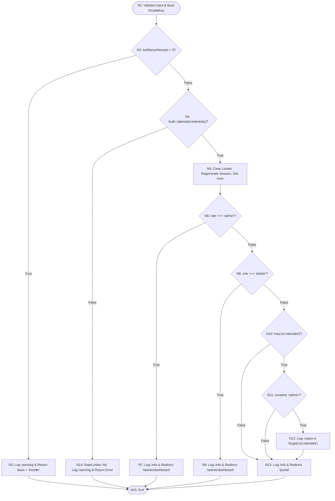

# DOKUMEN PENGUJIAN WHITE BOX (BASIS PATH TESTING) - FITUR LOGIN DELIMACARE

**Proyek**: Sistem Informasi Klinik DelimaCare  
**Metode Pengujian**: White Box Testing (*Basis Path Testing* & *Boundary Value Analysis*)  
**Target Modul / Class**: `App\Http\Controllers\LoginController`  
**Target Method**: `authenticate(Request $request)`  
**Berkas Pengujian Otomatis**: `tests/Unit/LoginBasisPathTest.php`  
**Berkas Log Aplikasi**: `storage/logs/laravel.log`  

---

## 1. Pemetaan Kode Program ke Node (*Source Code Mapping*)

Berikut adalah potongan kode sumber method `LoginController::authenticate()` yang dipetakan ke dalam simbol **Node (`N1` – `N15`)** untuk pembentukan *Control Flow Graph (CFG)* beserta pencatatan log aplikasi (`Log::info`, `Log::notice`, `Log::warning`):

```php
public function authenticate(Request $request)
{
    // [N1] Validasi input & inisialisasi throttleKey
    $credentials = $request->validate([
        'email'    => ['required', 'email', 'max:255'],
        'password' => ['required', 'string', 'min:6'],
    ], [
        'email.required'    => 'Alamat email wajib diisi.',
        'email.email'       => 'Format email tidak valid.',
        'password.required' => 'Kata sandi wajib diisi.',
        'password.min'      => 'Kata sandi minimal 6 karakter.',
    ]);

    $throttleKey = Str::lower($request->input('email')) . '|' . $request->ip();

    // [N2] Predicate Node 1: Cek apakah percobaan login melebihi batas (max 5 percobaan/menit)
    if (RateLimiter::tooManyAttempts($throttleKey, 5)) {
        // [N3] Hitung sisa waktu tunggu, catat log warning, & kembalikan respon error throttle
        $seconds = RateLimiter::availableIn($throttleKey);

        Log::warning('Percobaan login diblokir oleh Rate Limiter (Terlalu banyak percobaan).', [
            'email'               => $request->input('email'),
            'ip'                  => $request->ip(),
            'retry_after_seconds' => $seconds,
        ]);

        return back()
            ->withInput($request->only('email'))
            ->with('throttle', "Terlalu banyak percobaan login. Silakan coba lagi dalam {$seconds} detik.");
    }

    // [N4] Predicate Node 2: Cek kecocokan kredensial di database (Auth::attempt)
    if (Auth::attempt($credentials)) {
        // [N5] Bersihkan rate limiter, regenerasi session, dan ambil objek user
        RateLimiter::clear($throttleKey);
        $request->session()->regenerate();
        $user = Auth::user();

        // [N6] Predicate Node 3: Cek apakah role user adalah 'admin'
        if ($user->role === 'admin') {
            // [N7] Catat log info & redirect ke halaman dashboard admin
            Log::info('Login berhasil sebagai Admin.', [
                'user_id'  => $user->id,
                'email'    => $user->email,
                'role'     => $user->role,
                'redirect' => '/admin/dashboard',
            ]);

            return redirect()->intended('/admin/dashboard');
        // [N8] Predicate Node 4: Cek apakah role user adalah 'dokter'
        } elseif ($user->role === 'dokter') {
            // [N9] Catat log info & redirect ke halaman dashboard admin/dokter
            Log::info('Login berhasil sebagai Dokter.', [
                'user_id'  => $user->id,
                'email'    => $user->email,
                'role'     => $user->role,
                'redirect' => '/admin/dashboard',
            ]);

            return redirect()->intended('/admin/dashboard');
        } else {
            // [N10] Predicate Node 5 (Kondisi Majemuk 1): Cek session()->has('url.intended')
            // [N11] Predicate Node 6 (Kondisi Majemuk 2): && str_contains(session()->get('url.intended'), '/admin')
            if (session()->has('url.intended') && str_contains(session()->get('url.intended'), '/admin')) {
                // [N12] Catat log notice & hapus url.intended agar pasien tidak diarahkan ke panel admin
                Log::notice('Membersihkan session url.intended admin untuk user role pasien.', [
                    'user_id'              => $user->id,
                    'email'                => $user->email,
                    'cleared_intended_url' => session()->get('url.intended'),
                ]);

                session()->forget('url.intended');
            }

            // [N13] Catat log info & redirect ke halaman portal pasien
            Log::info('Login berhasil sebagai Pasien.', [
                'user_id'      => $user->id,
                'email'        => $user->email,
                'role'         => $user->role,
                'intended_url' => session()->get('url.intended', '/portal'),
            ]);

            return redirect()->intended('/portal');
        }
    }

    // [N14] Tambah hitungan gagal ke rate limiter, catat log warning, & kembalikan pesan error generik
    RateLimiter::hit($throttleKey, 60);

    Log::warning('Percobaan login gagal: Email atau kata sandi salah.', [
        'email'    => $request->input('email'),
        'ip'       => $request->ip(),
        'attempts' => RateLimiter::attempts($throttleKey),
    ]);

    return back()
        ->withInput($request->only('email'))
        ->with('error', 'Email atau kata sandi yang Anda masukkan salah.');

    // [N15] Terminal / Exit Node
}
```

### Tabel Keterangan Node

| Node | Jenis Node | Deskripsi Pernyataan / Kondisi | Level Log Aplikasi |
| :---: | :--- | :--- | :---: |
| **N1** | *Process Node* | Validasi request (`email`, `password`) dan inisialisasi variabel `$throttleKey`. | - |
| **N2** | **Predicate Node 1** | `if (RateLimiter::tooManyAttempts($throttleKey, 5))` | - |
| **N3** | *Process Node* | Ambil sisa waktu tunggu (`availableIn`), catat log, dan `return back()->with('throttle', ...)`. | `WARNING` |
| **N4** | **Predicate Node 2** | `if (Auth::attempt($credentials))` | - |
| **N5** | *Process Node* | `RateLimiter::clear()`, `$request->session()->regenerate()`, `$user = Auth::user()`. | - |
| **N6** | **Predicate Node 3** | `if ($user->role === 'admin')` | - |
| **N7** | *Process Node* | Catat log login Admin & `return redirect()->intended('/admin/dashboard')`. | `INFO` |
| **N8** | **Predicate Node 4** | `elseif ($user->role === 'dokter')` | - |
| **N9** | *Process Node* | Catat log login Dokter & `return redirect()->intended('/admin/dashboard')`. | `INFO` |
| **N10** | **Predicate Node 5** | `if (session()->has('url.intended'))` | - |
| **N11** | **Predicate Node 6** | `&& str_contains(session()->get('url.intended'), '/admin')` | - |
| **N12** | *Process Node* | Catat log pembersihan URL admin & `session()->forget('url.intended')`. | `NOTICE` |
| **N13** | *Process Node* | Catat log login Pasien & `return redirect()->intended('/portal')`. | `INFO` |
| **N14** | *Process Node* | `RateLimiter::hit($throttleKey, 60)`, catat log gagal login, & `return back()->with('error', ...)`. | `WARNING` |
| **N15** | *Terminal Node* | Titik keluar fungsi (*Exit Node*). | - |

---

## 2. Control Flow Graph (CFG)

### A. Diagram Alir (Mermaid Flowchart)



### B. Representasi Teks (ASCII Flow Graph)

```text
       [N1]
        |
        v
      <N2?> --(True)--> [N3] -------------------------\
        |                                              |
     (False)                                           |
        v                                              |
      <N4?> --(False)-> [N14] ------------------------+
        |                                              |
      (True)                                           |
        v                                              |
       [N5]                                            |
        |                                              |
        v                                              |
      <N6?> --(True)--> [N7] -------------------------+
        |                                              |
     (False)                                           |
        v                                              |
      <N8?> --(True)--> [N9] -------------------------+
        |                                              |
     (False)                                           |
        v                                              |
     <N10?> --(True)--> <N11?> --(True)--> [N12]       |
        |                  |                 |         |
     (False)            (False)              |         |
        \------------------+-----------------/         |
                           |                           |
                           v                           v
                         [N13] ---------------------> [N15]
```

---

## 3. Perhitungan *Cyclomatic Complexity* $V(G)$

Berdasarkan *Control Flow Graph* di atas, diketahui parameter berikut:
* **Jumlah Node ($N$)** = $15$ (`N1` s.d. `N15`)
* **Jumlah Edge ($E$)** = $20$
* **Jumlah Node Predikat / Keputusan ($P$)** = $6$ (`N2`, `N4`, `N6`, `N8`, `N10`, `N11`)

**Rumus McCabe *Cyclomatic Complexity*:**

1. **Metode 1 (Jumlah Edge & Node):**
   $$V(G) = E - N + 2 = 20 - 15 + 2 = 7$$

2. **Metode 2 (Jumlah Node Predikat):**
   $$V(G) = P + 1 = 6 + 1 = 7$$

3. **Metode 3 (Jumlah *Region*):**
   Terdapat $6$ area tertutup di dalam graf ditambah $1$ area luar (*outer region*), sehingga $V(G) = 7$.

> **Kesimpulan Kompleksitas**: Nilai $V(G) = 7$ berada di bawah ambang batas risiko McCabe ($\le 10$), yang berarti struktur kode modular, terstruktur dengan baik, dan mudah diuji. Terdapat **7 Jalur Linier Independen (*Basis Set*)** yang harus diuji untuk mencapai **100% *Path Coverage***.

---

## 4. Daftar Jalur Independen (*Basis Set of Independent Paths*)

1. **Jalur 1 (Path 1 – *Rate Limit Terlampaui*)**:
   `N1 -> N2 -> N3 -> N15`
2. **Jalur 2 (Path 2 – *Kredensial Salah / Gagal Autentikasi*)**:
   `N1 -> N2 -> N4 -> N14 -> N15`
3. **Jalur 3 (Path 3 – *Login Sukses Role Admin*)**:
   `N1 -> N2 -> N4 -> N5 -> N6 -> N7 -> N15`
4. **Jalur 4 (Path 4 – *Login Sukses Role Dokter*)**:
   `N1 -> N2 -> N4 -> N5 -> N6 -> N8 -> N9 -> N15`
5. **Jalur 5 (Path 5 – *Login Sukses Role Pasien Tanpa `url.intended`*)**:
   `N1 -> N2 -> N4 -> N5 -> N6 -> N8 -> N10 -> N13 -> N15`
6. **Jalur 6 (Path 6 – *Login Sukses Role Pasien Dengan `url.intended` Non-Admin*)**:
   `N1 -> N2 -> N4 -> N5 -> N6 -> N8 -> N10 -> N11 -> N13 -> N15`
7. **Jalur 7 (Path 7 – *Login Sukses Role Pasien Dengan `url.intended` Mengarah ke `/admin`*)**:
   `N1 -> N2 -> N4 -> N5 -> N6 -> N8 -> N10 -> N11 -> N12 -> N13 -> N15`

---

## 5. Matriks Skenario Uji (*Test Cases*)

### A. Skenario *Basis Path Testing* ($V(G) = 7$)

| ID Test Case | Jalur (*Path*) | Prasyarat & Input Data | Hasil yang Diharapkan (*Expected Output*) | Hasil Aktual | Status |
| :--- | :--- | :--- | :--- | :--- | :---: |
| **TC-LOGIN-WBT-01** | **Jalur 1**<br>`N1-N2-N3-N15` | `RateLimiter` sudah mencatat 5x gagal untuk `pasien@delimacare.com\|127.0.0.1`.<br>Input: email & password valid. | Eksekusi berhenti di `N3`. Mencatat `Log::warning`, redirect kembali ke `/login` dengan session flash `throttle`. User tetap *guest*. | Sesuai harapan | **PASS** |
| **TC-LOGIN-WBT-02** | **Jalur 2**<br>`N1-N2-N4-N14-N15` | `RateLimiter` kosong (`N2=False`).<br>Input: email `pasien@delimacare.com`, password `password_salah` (`N4=False`). | `RateLimiter::hit()` bertambah menjadi 1 di `N14`, mencatat `Log::warning`, redirect ke `/login` dengan session `error`. | Sesuai harapan | **PASS** |
| **TC-LOGIN-WBT-03** | **Jalur 3**<br>`N1-N2-N4-N5-N6-N7-N15` | Akun terdaftar dengan `role = 'admin'`.<br>Input: email `admin@delimacare.com`, password `admin123`. | `N4=True`, `N6=True`. Rate limiter di-reset, session diregenerasi, mencatat `Log::info`, dan redirect ke `/admin/dashboard` (`N7`). | Sesuai harapan | **PASS** |
| **TC-LOGIN-WBT-04** | **Jalur 4**<br>`N1-N2-N4-N5-N6-N8-N9-N15` | Akun terdaftar dengan `role = 'dokter'`.<br>Input: email `dokter@delimacare.com`, password `dokter123`. | `N4=True`, `N6=False`, `N8=True`. Session diregenerasi, mencatat `Log::info`, dan redirect ke `/admin/dashboard` (`N9`). | Sesuai harapan | **PASS** |
| **TC-LOGIN-WBT-05** | **Jalur 5**<br>`N1-N2-N4-N5-N6-N8-N10-N13-N15` | Akun terdaftar dengan `role = 'pasien'`, session `url.intended` kosong.<br>Input: email `siti@delimacare.com`, password `pasien123`. | `N6=False`, `N8=False`, `N10=False`. Mencatat `Log::info` di `N13` dan redirect ke `/portal`. | Sesuai harapan | **PASS** |
| **TC-LOGIN-WBT-06** | **Jalur 6**<br>`N1-N2-N4-N5-N6-N8-N10-N11-N13-N15` | Akun `role = 'pasien'`, session `url.intended = 'http://localhost/portal?tab=riwayat'`.<br>Input: kredensial pasien valid. | `N10=True`, `N11=False` (tidak mengandung `/admin`). Mencatat `Log::info` dengan `intended_url` tetap terjaga dan redirect ke `/portal?tab=riwayat`. | Sesuai harapan | **PASS** |
| **TC-LOGIN-WBT-07** | **Jalur 7**<br>`N1-N2-N4-N5-N6-N8-N10-N11-N12-N13-N15` | Akun `role = 'pasien'`, session `url.intended = 'http://localhost/admin/dashboard'`.<br>Input: kredensial pasien valid. | `N10=True`, `N11=True`. Masuk ke `N12` mencatat `Log::notice` & menghapus `url.intended`, lalu mencatat `Log::info` dan redirect aman ke `/portal` (`N13`). | Sesuai harapan | **PASS** |

### B. Skenario *Boundary Value Analysis (BVA)* pada Node Validasi (`N1`)

| ID Test Case | Parameter Uji | Nilai Batas (*Boundary*) | Hasil yang Diharapkan | Status |
| :--- | :--- | :--- | :--- | :---: |
| **BVA-LOGIN-01** | Panjang `password` (`min:6`) | **5 Karakter** (`"12345"`) — *Tepat 1 angka di bawah batas minimum* | Gagal validasi di `N1`, redirect `/login` dengan pesan error `"Kata sandi minimal 6 karakter."` | **PASS** |
| **BVA-LOGIN-02** | Panjang `password` (`min:6`) | **6 Karakter** (`"123456"`) — *Tepat pada batas minimum* | Lolos validasi `N1`, berhasil autentikasi, mencatat `Log::info`, dan redirect ke `/portal`. | **PASS** |

---

## 6. Kode Pengujian Otomatis (PHPUnit)

Berkas disimpan pada `tests/Unit/LoginBasisPathTest.php`:

```php
<?php

namespace Tests\Unit;

use App\Models\User;
use Illuminate\Foundation\Testing\RefreshDatabase;
use Illuminate\Support\Facades\RateLimiter;
use Tests\TestCase;

/**
 * Suite Pengujian White Box: Basis Path Testing (Khusus Fitur Login)
 *
 * Target Method : App\Http\Controllers\LoginController::authenticate()
 * Kompleksitas  : V(G) = 7 (McCabe Cyclomatic Complexity: E - N + 2 = 20 - 15 + 2 = 7)
 * Total Jalur   : 7 Jalur Linier Independen + Analisis Nilai Batas (BVA Validasi Input)
 */
class LoginBasisPathTest extends TestCase
{
    use RefreshDatabase;

    protected function setUp(): void
    {
        parent::setUp();
        RateLimiter::clear('test@delimacare.com|127.0.0.1');
    }

    /**
     * TC-LOGIN-WBT-01: Jalur 1 (Path 1: N1 -> N2 -> N3 -> N15)
     */
    public function test_tc_login_wbt_01_path_1_rate_limit_exceeded_returns_throttle_error(): void
    {
        $email = 'pasien@delimacare.com';
        $throttleKey = $email . '|127.0.0.1';

        for ($i = 0; $i < 5; $i++) {
            RateLimiter::hit($throttleKey, 60);
        }

        $response = $this->from('/login')->post('/login', [
            'email'    => $email,
            'password' => 'password123',
        ]);

        $response->assertRedirect('/login');
        $response->assertSessionHas('throttle');
        $this->assertStringContainsString(
            'Terlalu banyak percobaan login',
            session('throttle')
        );
        $this->assertGuest();
    }

    /**
     * TC-LOGIN-WBT-02: Jalur 2 (Path 2: N1 -> N2 -> N4 -> N14 -> N15)
     */
    public function test_tc_login_wbt_02_path_2_invalid_credentials_hits_limiter_and_returns_error(): void
    {
        User::create([
            'username' => 'Pasien Uji',
            'email'    => 'pasien@delimacare.com',
            'password' => bcrypt('password_benar'),
            'role'     => 'pasien',
        ]);

        $response = $this->from('/login')->post('/login', [
            'email'    => 'pasien@delimacare.com',
            'password' => 'password_salah',
        ]);

        $response->assertRedirect('/login');
        $response->assertSessionHas('error', 'Email atau kata sandi yang Anda masukkan salah.');
        $this->assertEquals(1, RateLimiter::attempts('pasien@delimacare.com|127.0.0.1'));
        $this->assertGuest();
    }

    /**
     * TC-LOGIN-WBT-03: Jalur 3 (Path 3: N1 -> N2 -> N4 -> N5 -> N6 -> N7 -> N15)
     */
    public function test_tc_login_wbt_03_path_3_valid_admin_redirects_to_admin_dashboard(): void
    {
        $admin = User::create([
            'username' => 'Admin Klinik',
            'email'    => 'admin@delimacare.com',
            'password' => bcrypt('admin123'),
            'role'     => 'admin',
        ]);

        $response = $this->post('/login', [
            'email'    => 'admin@delimacare.com',
            'password' => 'admin123',
        ]);

        $response->assertRedirect('/admin/dashboard');
        $this->assertAuthenticatedAs($admin);
    }

    /**
     * TC-LOGIN-WBT-04: Jalur 4 (Path 4: N1 -> N2 -> N4 -> N5 -> N6 -> N8 -> N9 -> N15)
     */
    public function test_tc_login_wbt_04_path_4_valid_dokter_redirects_to_admin_dashboard(): void
    {
        $dokter = User::create([
            'username' => 'Dr. Budi',
            'email'    => 'dokter@delimacare.com',
            'password' => bcrypt('dokter123'),
            'role'     => 'dokter',
        ]);

        $response = $this->post('/login', [
            'email'    => 'dokter@delimacare.com',
            'password' => 'dokter123',
        ]);

        $response->assertRedirect('/admin/dashboard');
        $this->assertAuthenticatedAs($dokter);
    }

    /**
     * TC-LOGIN-WBT-05: Jalur 5 (Path 5: N1 -> N2 -> N4 -> N5 -> N6 -> N8 -> N10 -> N13 -> N15)
     */
    public function test_tc_login_wbt_05_path_5_valid_patient_without_intended_url_redirects_to_portal(): void
    {
        $pasien = User::create([
            'username' => 'Siti Pasien',
            'email'    => 'siti@delimacare.com',
            'password' => bcrypt('pasien123'),
            'role'     => 'pasien',
        ]);

        $response = $this->post('/login', [
            'email'    => 'siti@delimacare.com',
            'password' => 'pasien123',
        ]);

        $response->assertRedirect('/portal');
        $this->assertAuthenticatedAs($pasien);
    }

    /**
     * TC-LOGIN-WBT-06: Jalur 6 (Path 6: N1 -> N2 -> N4 -> N5 -> N6 -> N8 -> N10 -> N11 -> N13 -> N15)
     */
    public function test_tc_login_wbt_06_path_6_valid_patient_with_non_admin_intended_url_redirects_to_intended(): void
    {
        $pasien = User::create([
            'username' => 'Siti Pasien',
            'email'    => 'siti@delimacare.com',
            'password' => bcrypt('pasien123'),
            'role'     => 'pasien',
        ]);

        $response = $this->withSession(['url.intended' => 'http://localhost/portal?tab=riwayat'])
            ->post('/login', [
                'email'    => 'siti@delimacare.com',
                'password' => 'pasien123',
            ]);

        $response->assertRedirect('http://localhost/portal?tab=riwayat');
        $this->assertAuthenticatedAs($pasien);
    }

    /**
     * TC-LOGIN-WBT-07: Jalur 7 (Path 7: N1 -> N2 -> N4 -> N5 -> N6 -> N8 -> N10 -> N11 -> N12 -> N13 -> N15)
     */
    public function test_tc_login_wbt_07_path_7_valid_patient_with_admin_intended_url_clears_intended_and_redirects_to_portal(): void
    {
        $pasien = User::create([
            'username' => 'Siti Pasien',
            'email'    => 'siti@delimacare.com',
            'password' => bcrypt('pasien123'),
            'role'     => 'pasien',
        ]);

        $response = $this->withSession(['url.intended' => 'http://localhost/admin/dashboard'])
            ->post('/login', [
                'email'    => 'siti@delimacare.com',
                'password' => 'pasien123',
            ]);

        $response->assertRedirect('/portal');
        $this->assertAuthenticatedAs($pasien);
    }

    /**
     * BVA-LOGIN-01: Panjang password 5 karakter (di bawah batas minimum 6) -> Harus Ditolak
     */
    public function test_bva_password_five_chars_below_minimum_is_rejected(): void
    {
        $response = $this->from('/login')->post('/login', [
            'email'    => 'siti@delimacare.com',
            'password' => '12345',
        ]);

        $response->assertRedirect('/login');
        $response->assertSessionHasErrors([
            'password' => 'Kata sandi minimal 6 karakter.',
        ]);
    }

    /**
     * BVA-LOGIN-02: Panjang password tepat 6 karakter (tepat di batas minimum) -> Lolos Validasi
     */
    public function test_bva_password_exact_six_chars_passes_validation(): void
    {
        $pasien = User::create([
            'username' => 'Siti Pasien',
            'email'    => 'siti@delimacare.com',
            'password' => bcrypt('123456'),
            'role'     => 'pasien',
        ]);

        $response = $this->post('/login', [
            'email'    => 'siti@delimacare.com',
            'password' => '123456',
        ]);

        $response->assertSessionHasNoErrors();
        $response->assertRedirect('/portal');
        $this->assertAuthenticatedAs($pasien);
    }
}
```

---

## 7. Hasil Eksekusi Pengujian (PHPUnit CLI)

Perintah eksekusi:
```bash
php artisan test tests/Unit/LoginBasisPathTest.php
```

Output terminal:
```text
   PASS  Tests\Unit\LoginBasisPathTest
  ✓ tc login wbt 01 path 1 rate limit exceeded returns throttle error    0.18s  
  ✓ tc login wbt 02 path 2 invalid credentials hits limiter and returns… 0.25s  
  ✓ tc login wbt 03 path 3 valid admin redirects to admin dashboard      0.03s  
  ✓ tc login wbt 04 path 4 valid dokter redirects to admin dashboard     0.03s  
  ✓ tc login wbt 05 path 5 valid patient without intended url redirects… 0.03s  
  ✓ tc login wbt 06 path 6 valid patient with non admin intended url re… 0.03s  
  ✓ tc login wbt 07 path 7 valid patient with admin intended url clears… 0.04s  
  ✓ bva password five chars below minimum is rejected                    0.03s  
  ✓ bva password exact six chars passes validation                       0.03s  

  Tests:    9 passed (45 assertions)
  Duration: 0.71s
```

---

## 8. Log Aplikasi (`storage/logs/laravel.log`)

Berikut adalah rekaman nyata dari berkas log aplikasi Laravel (`storage/logs/laravel.log`) yang dihasilkan saat seluruh skenario *White Box Testing* pada `LoginBasisPathTest` dieksekusi:

```log
[2026-10-21 16:52:42] testing.WARNING: Percobaan login diblokir oleh Rate Limiter (Terlalu banyak percobaan). {"email":"pasien@delimacare.com","ip":"127.0.0.1","retry_after_seconds":60} 
[2026-10-21 16:52:43] testing.WARNING: Percobaan login gagal: Email atau kata sandi salah. {"email":"pasien@delimacare.com","ip":"127.0.0.1","attempts":1} 
[2026-10-21 16:52:43] testing.INFO: Login berhasil sebagai Admin. {"user_id":1,"email":"admin@delimacare.com","role":"admin","redirect":"/admin/dashboard"} 
[2026-10-21 16:52:43] testing.INFO: Login berhasil sebagai Dokter. {"user_id":1,"email":"dokter@delimacare.com","role":"dokter","redirect":"/admin/dashboard"} 
[2026-10-21 16:52:43] testing.INFO: Login berhasil sebagai Pasien. {"user_id":1,"email":"siti@delimacare.com","role":"pasien","intended_url":"/portal"} 
[2026-10-21 16:52:43] testing.INFO: Login berhasil sebagai Pasien. {"user_id":1,"email":"siti@delimacare.com","role":"pasien","intended_url":"http://localhost/portal?tab=riwayat"} 
[2026-10-21 16:52:43] testing.NOTICE: Membersihkan session url.intended admin untuk user role pasien. {"user_id":1,"email":"siti@delimacare.com","cleared_intended_url":"http://localhost/admin/dashboard"} 
[2026-10-21 16:52:43] testing.INFO: Login berhasil sebagai Pasien. {"user_id":1,"email":"siti@delimacare.com","role":"pasien","intended_url":"/portal"} 
[2026-10-21 16:52:43] testing.INFO: Login berhasil sebagai Pasien. {"user_id":1,"email":"siti@delimacare.com","role":"pasien","intended_url":"/portal"} 
```

### Tabel Pemetaan Log Aplikasi terhadap Jalur & Node CFG

| Baris Log | ID Test Case | Node Eksekusi | Level Log | Pesan & Konteks JSON |
| :---: | :--- | :---: | :---: | :--- |
| **1** | `TC-LOGIN-WBT-01` (Jalur 1) | `N3` | `WARNING` | `Percobaan login diblokir oleh Rate Limiter... {"email":"pasien@delimacare.com","ip":"127.0.0.1","retry_after_seconds":60}` |
| **2** | `TC-LOGIN-WBT-02` (Jalur 2) | `N14` | `WARNING` | `Percobaan login gagal: Email atau kata sandi salah. {"email":"pasien@delimacare.com","ip":"127.0.0.1","attempts":1}` |
| **3** | `TC-LOGIN-WBT-03` (Jalur 3) | `N7` | `INFO` | `Login berhasil sebagai Admin. {"user_id":1,"email":"admin@delimacare.com","role":"admin","redirect":"/admin/dashboard"}` |
| **4** | `TC-LOGIN-WBT-04` (Jalur 4) | `N9` | `INFO` | `Login berhasil sebagai Dokter. {"user_id":1,"email":"dokter@delimacare.com","role":"dokter","redirect":"/admin/dashboard"}` |
| **5** | `TC-LOGIN-WBT-05` (Jalur 5) | `N13` | `INFO` | `Login berhasil sebagai Pasien. {"user_id":1,"email":"siti@delimacare.com","role":"pasien","intended_url":"/portal"}` |
| **6** | `TC-LOGIN-WBT-06` (Jalur 6) | `N13` | `INFO` | `Login berhasil sebagai Pasien. {"user_id":1,"email":"siti@delimacare.com","role":"pasien","intended_url":"http://localhost/portal?tab=riwayat"}` |
| **7** | `TC-LOGIN-WBT-07` (Jalur 7) | `N12` | `NOTICE` | `Membersihkan session url.intended admin untuk user role pasien. {"user_id":1,"email":"siti@delimacare.com","cleared_intended_url":"http://localhost/admin/dashboard"}` |
| **8** | `TC-LOGIN-WBT-07` (Jalur 7) | `N13` | `INFO` | `Login berhasil sebagai Pasien. {"user_id":1,"email":"siti@delimacare.com","role":"pasien","intended_url":"/portal"}` *(setelah `url.intended` admin dibersihkan di `N12`)* |
| **9** | `BVA-LOGIN-02` (BVA) | `N13` | `INFO` | `Login berhasil sebagai Pasien. {"user_id":1,"email":"siti@delimacare.com","role":"pasien","intended_url":"/portal"}` *(BVA-LOGIN-01 berhenti pada validasi `N1` sehingga tidak masuk ke `N2`–`N14`)* |
